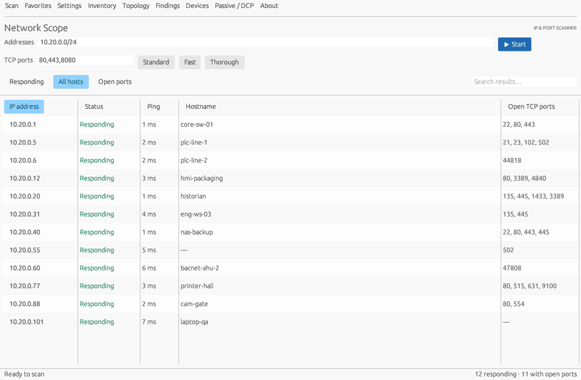
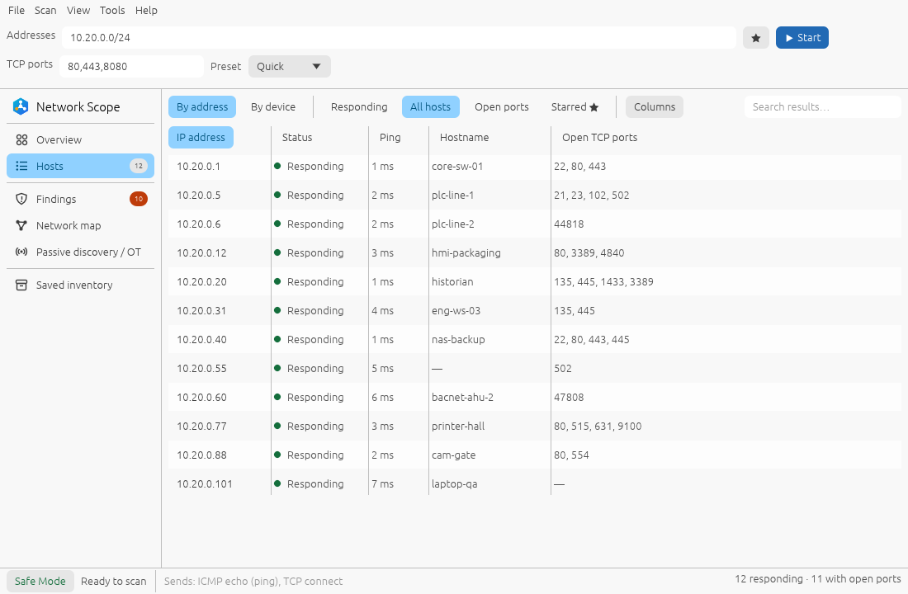
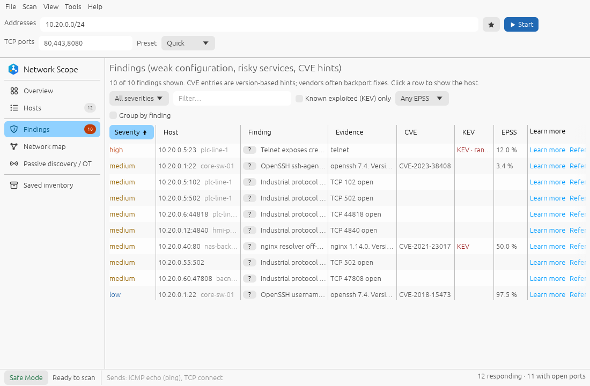
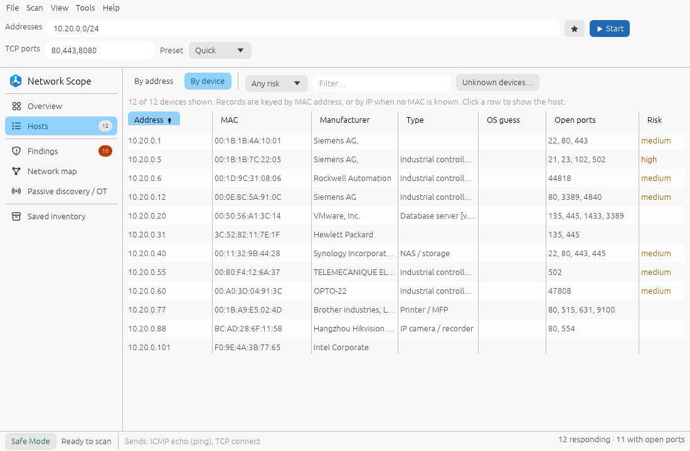
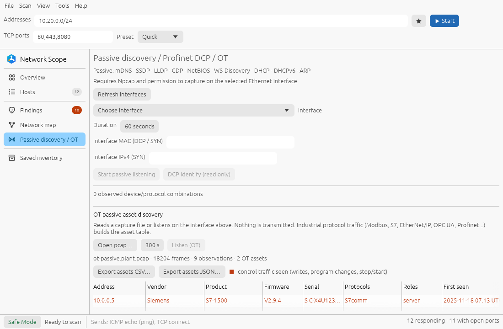
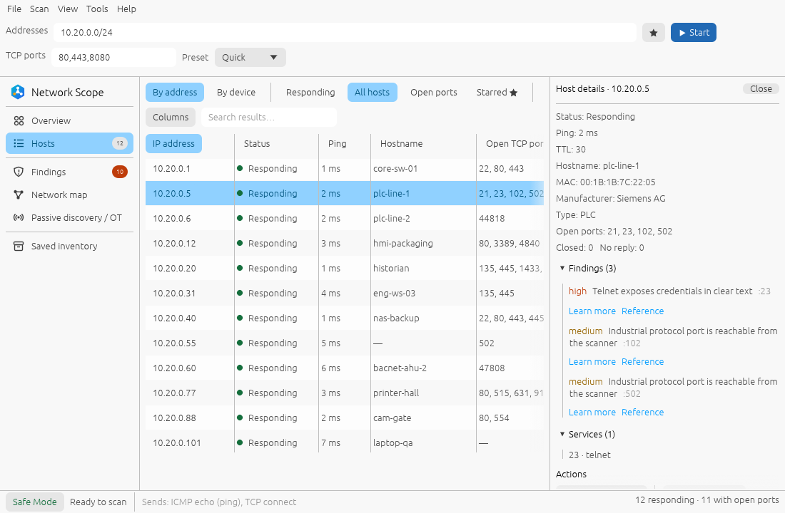
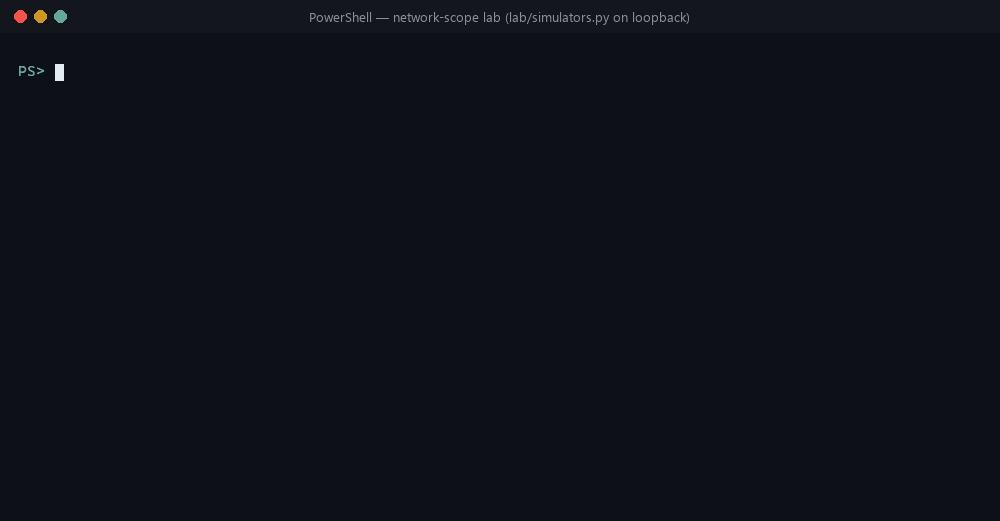

<div align="center">

<picture>
  <source media="(prefers-color-scheme: dark)" srcset="assets/logo-dark.svg">
  
</picture>

<p>
  <a href="https://github.com/Sparkz400/network-scope/actions/workflows/ci.yml"></a>
  <a href="https://github.com/Sparkz400/network-scope/releases/latest"></a>
  <a href="LICENSE.txt"></a>
  <a href="https://www.bestpractices.dev/projects/16920"></a>
  <a href="https://scorecard.dev/viewer/?uri=github.com/Sparkz400/network-scope"></a>
  
  
</p>

**Portable network discovery and inventory for IT and OT networks: desktop GUI, CLI and live TUI in one Rust binary.**



<sub>Desktop tour with a sample plant network.</sub>

</div>

Network Scope finds the hosts on a network, identifies what runs on them, flags risky configurations and keeps every scan in a local SQLite inventory so you can see what changed. It is built for mixed office and plant networks: industrial devices are identified with read-only requests, and a passive mode builds an OT asset list from a capture without sending a single packet. Safe Mode is on by default.

## Features

- **Fast discovery**: async TCP connect scanning (no driver, no admin rights), optional SYN scanning, ARP and ICMP discovery, UDP probes, traceroute (ICMP/TCP/UDP).
- **Service detection**: banners and data-driven probes, HTTP, TLS (certificate, versions, cipher suites, JA3S fingerprint), SSH (HASSHServer), SMB 2/3 and SMBv1, RDP, LDAP, databases.
- **Risk findings and CVE hints**: weak TLS/SSH, cleartext protocols, unauthenticated services, SMB signing/encryption, plus version-based CVE hints with CPE names.
- **OT / industrial**: read-only identification of Modbus/TCP, S7, EtherNet/IP, BACnet/IP and OPC UA; passive OT asset discovery from pcap/pcapng or a live interface, with control-traffic detection.
- **Inventory and diffs**: every scan stored in SQLite; diffs with new, resolved and unconfirmed findings; device timelines across scans.
- **Monitoring**: repeated scans with alerts for new devices, new ports, new findings and rogue DHCP servers, delivered to a file, webhook or syslog.
- **Reports and exports**: self-contained HTML report with charts and a network map, Markdown, JSON, JSON Lines, CSV, and nmap-compatible XML import/export.
- **Scripting**: sandboxed [Rhai](https://rhai.rs) scripts add your own identity fields, findings and notes per host.
- **Three front ends**: egui desktop app, scriptable CLI, ratatui live terminal view.
- **Portable**: a GUI and a console executable, no runtime, no installer required; SQLite is bundled.

<details>
<summary>Screenshots</summary>

| Main window | Findings |
| --- | --- |
|  |  |
| **Hosts by device** | **OT passive discovery** |
|  |  |
| **Script dry-run** | |
|  | |

</details>

## Install

### Windows

Download from the [latest release](https://github.com/Sparkz400/network-scope/releases/latest):

| File | What it is |
| --- | --- |
| `NetworkScope-<version>-setup.exe` | Installer (per-user by default, optional PATH entry for the CLI, start menu shortcut) |
| `network-scope-<version>-windows-x64.zip` | Portable: `network-scope.exe` (GUI) and `network-scope-cli.exe` (console) |
| `SHA256SUMS` | Checksums for all release files |

The binaries are not code-signed yet, so Windows SmartScreen will warn on first start. Verify the checksum if in doubt. The project is applying for free code signing provided by [SignPath.io](https://signpath.io), certificate by [SignPath Foundation](https://signpath.org); see the [code signing policy](https://sparkz400.github.io/network-scope/code-signing-policy.html).

### Linux and macOS

Release archives `network-scope-<version>-linux-x86_64.tar.gz` and `network-scope-<version>-macos-arm64.tar.gz` contain both binaries. The Linux and macOS platform code is built and tested only in CI and has not been used on a real network yet.

### Container

Each release publishes the CLI as a container image (linux/amd64) on GitHub Container Registry:

```sh
docker run --rm ghcr.io/sparkz400/network-scope:latest scan 192.168.1.0/24 --tcp-only
```

The image runs as an unprivileged user, and TCP connect scanning needs nothing more. Raw sockets, ICMP fallbacks, ARP and capture features need `--user root --cap-add NET_RAW`, and `--network host` to see the local LAN directly instead of the container's bridge network. Safe Mode still applies inside the container. Saved scans go to `/data` (mount a volume there to keep them). Pin a version tag (`:0.6.0`) instead of `:latest` for reproducible runs; see [SECURITY.md](SECURITY.md#verifying-releases) for verifying the image and release files.

<details>
<summary>Build from source</summary>

Requires a current stable Rust toolchain.

```sh
git clone https://github.com/Sparkz400/network-scope
cd network-scope
cargo build --release --locked
# binaries: target/release/network-scope and target/release/network-scope-cli
```

On Linux the GUI needs the usual X11/Wayland development packages (Debian/Ubuntu: `libxkbcommon-dev libwayland-dev libx11-dev libgl1-mesa-dev libxcb-render0-dev libxcb-shape0-dev libxcb-xfixes0-dev`). See [Installation](docs/src/installation.md) for details.

</details>

## Quick start

Start the desktop app by double-clicking `network-scope.exe` (or running it without arguments). Nothing is scanned until you press **Start**.

From a shell, use `network-scope-cli` on Windows (`network-scope-cli` or `network-scope` elsewhere):

```sh
# Find hosts and identify services on a /24, live terminal view
network-scope-cli scan 192.168.1.0/24 --deep --tui

# List the findings of scan #1 and write an HTML report
network-scope-cli findings 1 --min-severity medium
network-scope-cli report 1 --output report.html

# Build an OT asset list from a capture file, without sending anything
network-scope-cli ot-listen --pcap plant.pcapng --progress
```

<p align="center"></p>

More in [Quick start](docs/src/quick-start.md) and the [CLI reference](docs/src/cli-reference.md).

## Privileges and Npcap

Most features need **no administrator rights and no driver**: TCP connect scanning, service and TLS detection, ICMP and ARP lookups through the operating system, UDP probes, reports, inventory, monitoring and pcap file analysis.

A few features send or capture raw packets and need a capture driver plus the rights to use it:

| Feature | Needs |
| --- | --- |
| SYN scan (`--syn`), ARP sweep (`--arp-sweep`), TCP traceroute | Npcap (Windows) or libpcap (Linux/macOS), capture rights, `--fast` |
| Passive capture (`listen`, `ot-listen --interface`), Profinet DCP | Npcap or libpcap, capture rights |
| UDP traceroute, ICMPv6 traceroute | Administrator / root (raw socket) |

On Windows install [Npcap](https://npcap.com/) separately; Network Scope never installs drivers or asks for elevation. On Linux and macOS run capture features as root (granting `cap_net_raw,cap_net_admin` with `setcap` should also work on Linux but is untested). If a driver is missing, SYN falls back to TCP connect and says so in the host notes. Details: [Installation](docs/src/installation.md#privileges).

## Safe Mode and OT safety

**Safe Mode is on by default.** It limits a scan to eight active hosts and at least 100 ms between application probes, and disables SYN, the ARP sweep and TCP/UDP traceroute. `--fast` (or unchecking Safe Mode) lifts these limits.

Industrial protocols are only ever **read**: identification requests, never writes, program access or control commands, even with Safe Mode off. Generic service probes never touch industrial or printer ports. Even so, fragile field devices can misbehave under any active traffic. Read [Safe Mode and OT safety](docs/src/safe-mode-and-ot-safety.md) before scanning a plant network, and prefer the passive mode where you can.

## Responsible use

- Scan only networks and devices you own or are explicitly authorized to test.
- Industrial and medical equipment can fault under active probing. Coordinate with operations, keep Safe Mode on, and prefer passive discovery on production OT networks.
- Network Scope is provided as is, without warranty (see [LICENSE.txt](LICENSE.txt)). You are responsible for complying with the laws and policies that apply to you.

More in [Responsible use](docs/src/responsible-use.md).

## Documentation

The full documentation lives in [`docs/src`](docs/src/SUMMARY.md) and is published at **<https://sparkz400.github.io/network-scope/>**:

- [Installation](docs/src/installation.md) · [Quick start](docs/src/quick-start.md) · [GUI guide](docs/src/gui-guide.md) · [CLI reference](docs/src/cli-reference.md)
- [Scanning engine](docs/src/scanning-engine.md) · [Detection](docs/src/detection.md) · [Findings and CVE hints](docs/src/findings-and-cves.md)
- [Inventory, diffs and reports](docs/src/inventory-diff-reports.md) · [Monitoring and alerts](docs/src/monitoring-alerts.md) · [Scripting](docs/src/scripting.md)
- [OT / industrial](docs/src/ot-industrial.md) · [Safe Mode and OT safety](docs/src/safe-mode-and-ot-safety.md) · [Lab and testing](docs/src/lab-and-testing.md)
- [FAQ and troubleshooting](docs/src/faq.md) · [Changelog](CHANGELOG.md) · [Roadmap](ROADMAP.md)

## Contributing

Bug reports, protocol samples and pull requests are welcome. Please read [CONTRIBUTING.md](CONTRIBUTING.md), especially the safety rules for new probes. Security issues: see [SECURITY.md](SECURITY.md). Questions: [SUPPORT.md](SUPPORT.md).

## Acknowledgements and data attribution

Network Scope is an original, independent application. It is built on many excellent Rust crates, including egui/eframe, Tokio, ratatui, rusqlite, rustls, x509-parser, pnet_packet and Rhai; the full list with licenses is in [THIRD-PARTY-NOTICES.md](THIRD-PARTY-NOTICES.md).

Embedded data: MAC vendor names come from the IEEE Registration Authority public registries; EtherNet/IP vendor names from the ODVA CIP vendor ID list. Provenance and licensing of every data file: [data/README.md](data/README.md).

Npcap is a separate product under its own license and is not bundled. nmap is a trademark of its owners; Network Scope reads and writes the documented nmap XML format and contains no nmap code or data.

## License

[MIT](LICENSE.txt)
